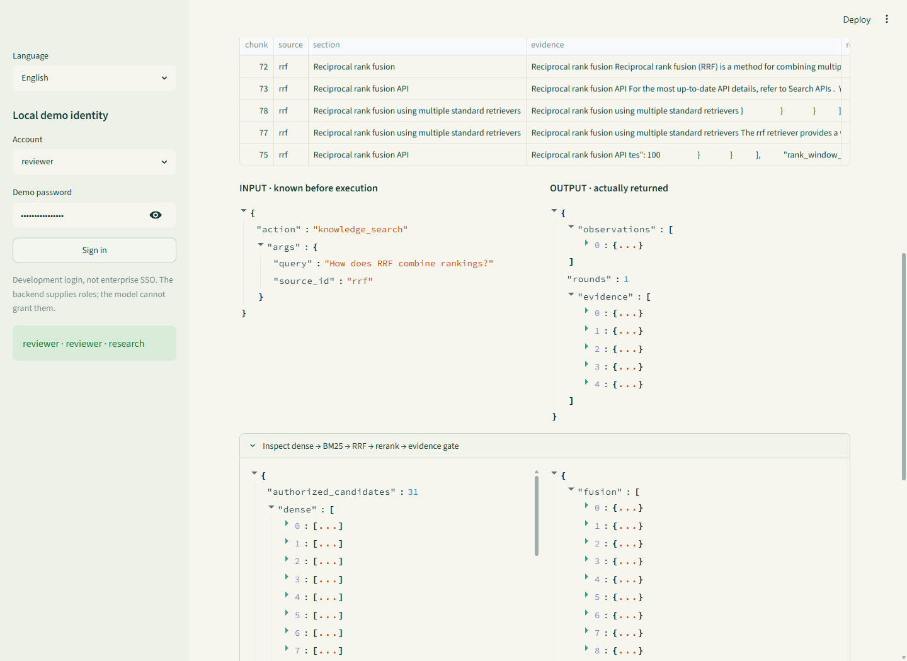
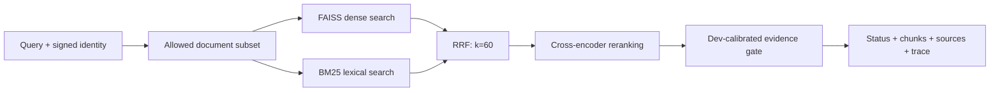

# Research Evidence Service — a separate, inspectable RAG boundary

**An agent should receive evidence it is allowed to use, not an opaque answer with lost provenance.**

This service supplies structured evidence to [Research Copilot](https://github.com/Boothill2001/AI_AGENT_LANGGHAPH). It searches real technical documentation, applies workspace permissions before ranking, exposes every retrieval stage, and can explicitly say that no sufficient evidence was found.

The companion Copilot owns planning, arithmetic, reviewer approval and report storage. This repository owns ingestion, source provenance and retrieval. The legacy tutorial `/ask` endpoint remains available separately; the new agent consumes authenticated `/search` so generation does not happen twice by default.



## Input → retrieval decisions → structured evidence



A request such as `{"query":"How does RRF combine rankings?","source_id":"rrf","mode":"rerank"}` returns:

- `status`: `ok`, `insufficient_evidence`, or `forbidden`; operational failures use HTTP errors.
- `evidence`: authorized chunk IDs, source URLs, section text, source hashes, rank contributions and scores.
- `trace`: authorized candidate count, dense and BM25 rankings, RRF fusion, reranking, gate decision, timings and corpus-manifest hash.

The bearer token arrives from the trusted agent runtime. There is no user-controlled role/workspace field in the request schema. Both retrievers search only allowed rows; this is not a top-k search followed by filtering. A blocked source returns no evidence. The same filter protects `/research/data` when inspecting chunks.

## The data is real; access-control fixtures are fictional

The recorded corpus contains **six official source pages**, **111 official-document chunks**, and **two synthetic chunks**, for **113 chunks total**:

| Source ID | Official source | Snapshot chunks |
|---|---|---:|
| `interrupts` | [LangGraph interrupts](https://docs.langchain.com/oss/python/langgraph/interrupts) | 38 |
| `persistence` | [LangGraph persistence](https://docs.langchain.com/oss/python/langgraph/persistence) | 6 |
| `mcp-architecture` | [MCP architecture](https://modelcontextprotocol.io/docs/learn/architecture) | 17 |
| `mcp-tools` | [MCP tools specification](https://modelcontextprotocol.io/specification/2025-06-18/server/tools) | 11 |
| `rrf` | [Elasticsearch RRF](https://www.elastic.co/docs/reference/elasticsearch/rest-apis/reciprocal-rank-fusion) | 31 |
| `reranking` | [Sentence Transformers retrieve/rerank](https://www.sbert.net/examples/sentence_transformer/applications/retrieve_rerank/README.html) | 8 |

`workspace-note` and `injection-fixture` are explicitly synthetic research-workspace documents, used only to exercise permissions and untrusted instructions. There are no real internal company secrets in the repository. The older eight self-authored Markdown tutorials remain a separate legacy corpus and are not counted as these official sources.

Ingestion removes layout/navigation content, chunks at a 1,200-character cap with 150-character overlap, and computes normalized **384-dimensional `all-MiniLM-L6-v2` embeddings**. Retrieval uses FAISS exact inner product, BM25, rank fusion with `k=60`, and **`cross-encoder/ms-marco-MiniLM-L-6-v2`**. Scores from the cross-encoder are not calibrated probabilities.

[research-manifest.json](research-manifest.json) records original/resolved URLs, fetch times, cleaned-content/response hashes, chunk counts and index hashes. Full publisher snapshots and vectors stay in ignored local storage. Cached snapshots are reused after hash validation; a fresh fetch of a mutable website can change the corpus and requires a new evaluation identity. The first measured snapshot contains some imperfectly decoded publisher punctuation; it has not been silently normalized and scored as if unchanged.

## A useful failure: stricter evidence loses one legitimate question

Eight development questions select the evidence gate. Eighteen different retrieval questions are then evaluated: **16 with expected source documents and two outside scope**.

| Configuration | Source hit@5 | Source MRR@5 | Unsupported queries accepted / 2 |
|---|---:|---:|---:|
| Dense, no gate | 16/16 | 0.8854 | 2 |
| Dense + BM25 + RRF, no gate | 16/16 | 0.9271 | 2 |
| Hybrid + cross-encoder + gate | 15/16 | 0.8490 | 0 |

The selected raw-score threshold is **−3.3842663764953613**: maximize development answerability F1, prefer fewer false accepts, then the higher threshold on a tie. Test questions do not select it.

The full pipeline rejects both unsupported questions, but also drops a legitimate RRF paraphrase. That is a visible false negative, not a result removed from the denominator. The full configuration changes reranking and gating together; these results do not isolate reranking's contribution. The benchmark labels expected **documents**, not exhaustive relevant chunks or complete answer faithfulness. Some other retrieved sources could also contain valid evidence. [Full retrieval report](research-evaluation.json) · [Dev gate selection](research-gate.json)

## Run the service

The easiest full walkthrough uses the companion Copilot's `start.bat`, with both repositories as siblings. See its [setup and learning guide](https://github.com/Boothill2001/AI_AGENT_LANGGHAPH).

Standalone retrieval setup on Windows, Python 3.11:

```powershell
py -3.11 -m venv .venv
.venv\Scripts\python.exe -m pip install -r requirements.txt
.venv\Scripts\python.exe scripts/ingest_research.py
.venv\Scripts\python.exe scripts/evaluate_research.py
.venv\Scripts\python.exe -m uvicorn api.research_app:app --host 127.0.0.1 --port 8011
```

The v2 service requires the shared `COPILOT_SECRET_FILE` generated by the companion agent, or the default sibling agent path. It verifies signed identity and audience; it does not accept identity claims from the query. For development, log in through the companion Agent API and pass that bearer token. This is local demo authentication, not production SSO or a complete token-revocation system.

| Endpoint | Behavior |
|---|---|
| `GET /research/health` | Index/gate readiness and manifest identity |
| `GET /research/data` | Authenticated, permission-filtered chunk inspection |
| `POST /search` | Authenticated structured evidence and retrieval trace |

The separate legacy service can still be started with `uvicorn api.main:app --port 8010`, exposing `/ask` over the original tutorial index. It retains its existing extractive fallback behavior. It does not expose the new workspace-only fixtures and is not the authenticated production-style research boundary. Legacy `scripts/build_index.py`, `scripts/evaluate.py` and `ui/app.py` are retained for that tutorial.

## Verify the boundary

```powershell
.venv\Scripts\python.exe -m pytest tests -q
```

Tests cover chunking, rank fusion and authorization before **both** retrievers. The ACL test deliberately gives a private chunk the strongest dense vector and a matching lexical term; it still cannot enter the outsider's candidate rankings. These unit tests use controlled vectors and require no API key or downloaded model. Actual local embedding/reranking measurements are recorded in the research report.

CI installs the small `requirements-ci.txt` test environment, runs unit checks and compiles code. It deliberately does not download mutable public documents, change a frozen benchmark, or call a paid model on every push. Install full `requirements.txt` for live service/model runs.

## Limits that matter

This is a small, historical technical-document experiment. It does not prove enterprise retrieval scale, semantic faithfulness of every answer, safe public deployment, actual employee permissions or business savings. Exact FAISS search over the authorized subset is appropriate at this corpus size and must be revisited for large, multi-tenant indexes. RBAC/workspace fixtures illustrate policy behavior; they are not access control over a real company's documents.
