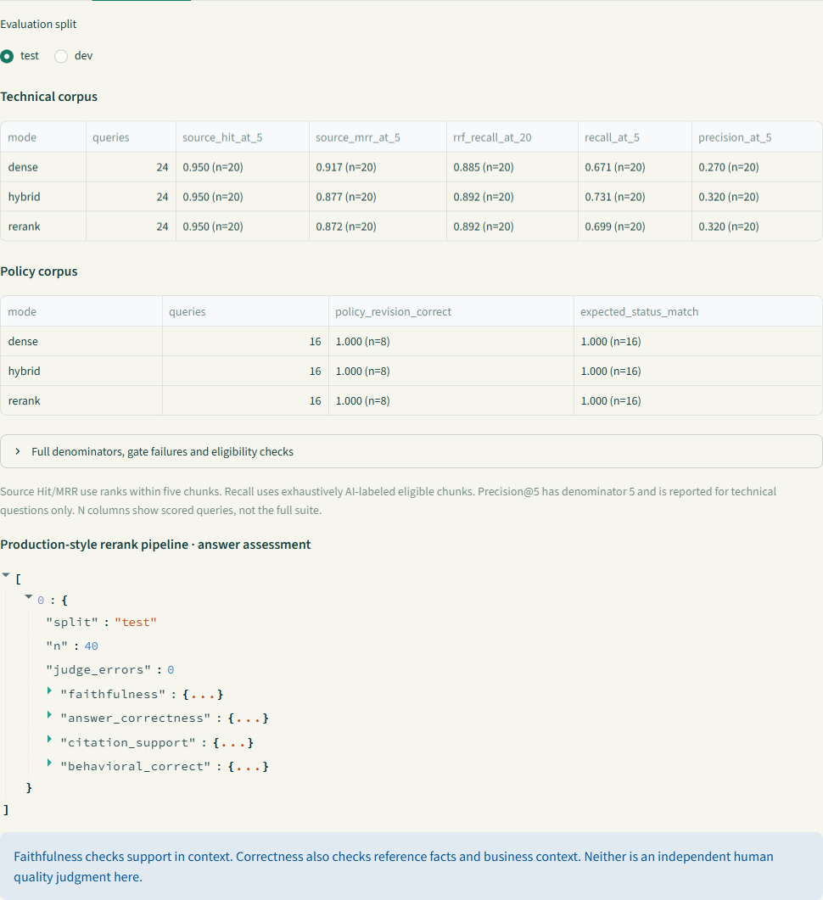
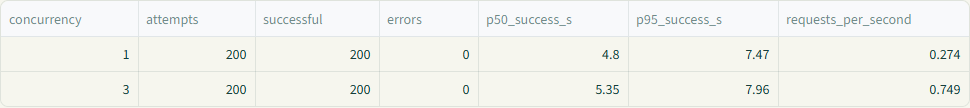
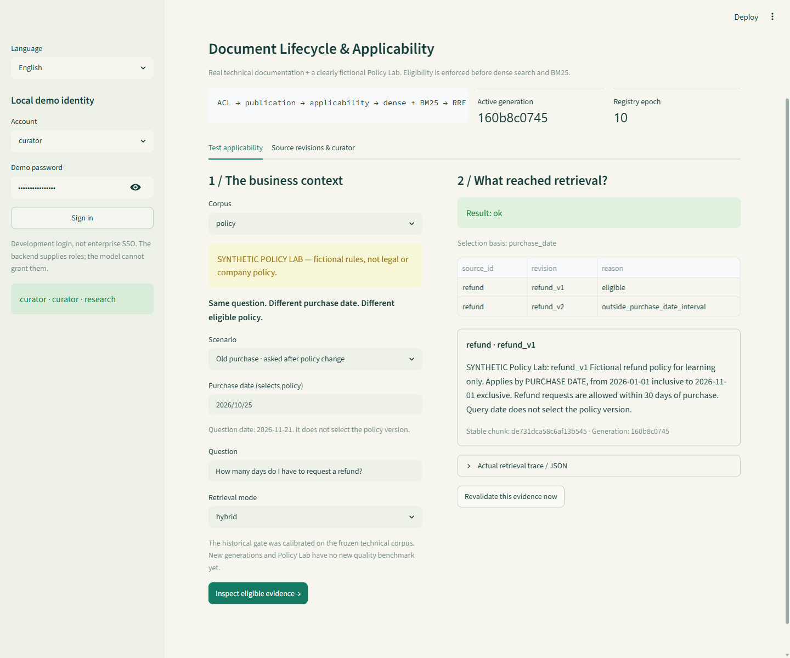
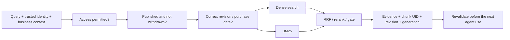
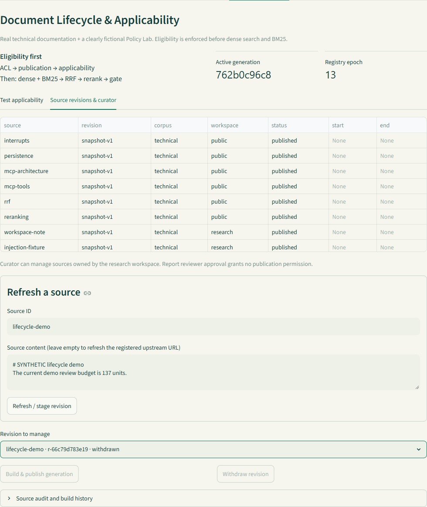
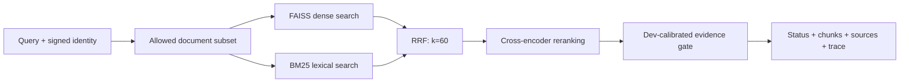

# Research Evidence Service — a separate, inspectable RAG boundary

**An agent should receive evidence it is allowed to use, not an opaque answer with lost provenance.**

This service supplies structured evidence to [Research Copilot](https://github.com/Boothill2001/langgraph-research-copilot). It searches real technical documentation, applies workspace permissions before ranking, exposes every retrieval stage, and can explicitly say that no sufficient evidence was found.

The companion Copilot owns planning, arithmetic, reviewer approval and report storage. This repository owns ingestion, source provenance and retrieval. The legacy tutorial `/ask` endpoint remains available separately; the new agent consumes authenticated `/search` so generation does not happen twice by default.


<!-- evidence-evaluation-v1:start -->
## Evaluation v1 — high source hit did not mean clean context

An actual test question about RRF point-in-time handling (`T03`) produced **31 fused candidates → 5 context chunks → 1 labeled relevant chunk**. Source Hit@5 and Recall@5 were both 1, while Precision@5 was only 0.2. Finding the right source did not make all the context useful.

The new suite has **20 dev / 40 test questions**, with 12 dev cases passing the pilot gate before test evaluation. The test includes 20 answerable technical questions, four unsupported questions and 16 synthetic policy/context/access cases. **All 60 cases have complete eligible-chunk label coverage; 180 retrieval configurations were measured.** Labels are AI-assisted, not independently human verified.

| Configuration | Source Hit@5 | Source MRR@5 | Chunk Recall@5 | Precision@5 | Unsupported accepted / 4 |
|---|---:|---:|---:|---:|---:|
| Dense | 19/20 | 0.9167 | 0.6706 | 0.2700 | 4 |
| Dense + BM25 + RRF | 19/20 | 0.8767 | 0.7311 | 0.3200 | 4 |
| Hybrid + rerank + gate | 19/20 | 0.8725 | 0.6994 | 0.3200 | 0 |

The full configuration rejected the four unsupported technical queries, but did not improve Source Hit@5; reranking and gating change together here, so this is not an isolated reranker-gain claim. Policy results are reported separately rather than padded into technical Precision@5. The frozen threshold was not tuned on this suite.



**An unresolved retrieval miss is retained:** `T22` returned MCP architecture chunks for a tool-pagination question, with labeled Recall@5=0. A perfect mean faithfulness on scored answers must not hide an uncertain/unscored difficult case. The report exposes per-question coverage, refusals and judge failures.

### HTTP latency is a separate experiment

| HTTP concurrency | Attempts | Errors | Warm p95, successful requests | Requests/s |
|---|---:|---:|---:|---:|
| 1 | 200 | 0 | 7.47 s | 0.274 |
| 3 | 200 | 0 | 7.96 s | 0.749 |


Both levels used the same fixed question workload, ten warm-ups excluded, and two CPU embedding/reranker threads. A separate process measured one cold first request; that one observation is not a cold p95. Successful-only and all-attempt percentiles, timeouts and corpus breakdowns are retained in the report. These are local client round-trip measurements, not a production SLO or the old internal-stage timings.

The target value is fewer unsupported source-backed responses and clearer diagnosis of wasted context. No customer savings or production impact was measured. [Full report](artifacts/evaluation-v1.json) · [Metric/label/timing contract](evaluation/README.md) · [AI-assisted qrels](evaluation/qrels-v1.json)
<!-- evidence-evaluation-v1:end -->

## A policy changed. The old purchase did not.

A customer bought on **October 25** and asked on **November 21**. A search engine that always picks the newest refund policy would select the wrong rule. This release makes **eligibility a prerequisite to relevance**, rather than asking an LLM to repair an invalid candidate set.



| Input | Decision before ranking | Output |
|---|---|---|
| Purchase `2026-10-25`, question `2026-11-21` | v1 applies to the purchase; v2 does not | `refund_v1`, 30-day window |
| Purchase `2026-10-31` | Last day of v1's half-open interval | Only v1 candidates |
| Purchase `2026-11-01` | First day of v2 | `refund_v2`, 7-day window |
| No purchase date | The business date is unknown | `needs_context`, no policy evidence |
| Explicit v2 + October purchase | Requested revision conflicts with purchase date | `context_conflict`, no evidence |
| Withdrawn source, including an explicit historical query | Live registry denies new use | No withdrawn chunk in dense or BM25 |

**Policy Lab is fictional English training data.** Its rules are not legal advice or a real company's policy. The technical corpus remains real official documentation. No PDF ingestion was added.



### Publication and withdrawal solve different problems

SQLite records source revisions, content hashes, ownership, publication state, defaults, audit events, build state and the active generation. Refresh is explicit: unchanged cleaned text updates its check time without another revision. A changed source is staged, not immediately searchable.

A build writes a **new immutable generation directory** with chunks, vectors, gate and a hashed manifest. Publication validates file hashes, row counts, finite vectors, dimensions, IDs and metadata. An SQLite transaction checks both the original generation and registry epoch before switching the serving pointer. A stale or failed build cannot overwrite newer work. Cache keys include the generation; requests pin one generation, and the next request sees publication without restarting the service.

**Withdrawal is immediate through the registry**, including for cached indexes and historical queries. Supersession only changes the default technical revision: an explicit historical revision can remain usable. Policy applicability uses purchase-date intervals, not upload date, document age or the newest revision. Overlapping published intervals in a policy family/workspace are rejected. Rollback restores a generation's defaults without undoing current withdrawals. A registry change during ranking discards that response, including its candidate trace, and asks the caller to retry.



### Try the complete lifecycle

Open the companion workspace, tab **06 · Document Lifecycle**. Sign in as `curator` to stage a fictional `lifecycle-demo` source, publish it, change its text and publish another generation. Sign in as `researcher` to search it, then withdraw the revision and revalidate the earlier evidence. A report `reviewer` cannot publish documents. Curators manage only sources owned by their workspace; source visibility and source ownership are separate.

[Live publication and date-boundary check](artifacts/lifecycle-runtime.json) records real CPU embedding/retrieval results, two generations, unchanged refresh, explicit historical lookup and withdrawal. This is an operational check, **not a new retrieval-quality score**.

| API | Boundary |
|---|---|
| `POST /search` | Optional `corpus`, `revision`, `purchase_date`; technical corpus remains the default |
| `GET /research/data` | The same ACL, lifecycle and applicability rules as search |
| `POST /research/validate` | Resolve immutable chunk references; validate current eligibility without trusting caller text |
| `GET /research/lifecycle` | Authorized source revisions and audit history; no forbidden source names/text |
| `POST /research/curator/refresh` | Stage inline text or explicitly refresh an existing registered URL |
| `POST /research/curator/publish` | Build, validate, then compare-and-swap publication |
| `POST /research/curator/withdraw` | Immediate registry revocation |
| `POST /research/curator/rollback` | Expected-generation check; current withdrawals still win |

**Evidence identity is not a new benchmark.** The committed historical `research-manifest.json`, `research-gate.json` and `research-evaluation.json` are preserved. Bootstrap creates separate generation manifests; their inherited gate is not newly calibrated on the Policy Lab or changed corpus. Runtime ingestion uses `--runtime-only` and does not overwrite those historical reports.

[Implementation notes](LIFECYCLE-NOTES.txt) · [Vietnamese hands-on guide](LIFECYCLE-GUIDE.vi.txt)

## Input → retrieval decisions → structured evidence



A request such as `{"query":"How does RRF combine rankings?","source_id":"rrf","mode":"rerank"}` returns:

- `status`: `ok`, `insufficient_evidence`, `needs_context`, `context_conflict`, or `registry_changed`; operational failures use HTTP errors.
- `evidence`: authorized chunk IDs, source URLs, section text, source hashes, rank contributions and scores.
- `trace`: authorized candidate count, dense and BM25 rankings, RRF fusion, reranking, gate decision, timings and corpus-manifest hash.

The bearer token arrives from the trusted agent runtime. There is no user-controlled role/workspace field in the request schema. Both retrievers search only allowed rows; this is not a top-k search followed by filtering. A blocked source returns no evidence. The same filter protects `/research/data` when inspecting chunks.

## The data is real; access-control fixtures are fictional

The frozen benchmark corpus contains **six official source pages**, **111 official-document chunks**, and **two synthetic chunks**, for **113 chunks total**:

| Source ID | Official source | Snapshot chunks |
|---|---|---:|
| `interrupts` | [LangGraph interrupts](https://docs.langchain.com/oss/python/langgraph/interrupts) | 38 |
| `persistence` | [LangGraph persistence](https://docs.langchain.com/oss/python/langgraph/persistence) | 6 |
| `mcp-architecture` | [MCP architecture](https://modelcontextprotocol.io/docs/learn/architecture) | 17 |
| `mcp-tools` | [MCP tools specification](https://modelcontextprotocol.io/specification/2025-06-18/server/tools) | 11 |
| `rrf` | [Elasticsearch RRF](https://www.elastic.co/docs/reference/elasticsearch/rest-apis/reciprocal-rank-fusion) | 31 |
| `reranking` | [Sentence Transformers retrieve/rerank](https://www.sbert.net/examples/sentence_transformer/applications/retrieve_rerank/README.html) | 8 |

`workspace-note` and `injection-fixture` are explicitly synthetic research-workspace documents, used only to exercise permissions and untrusted instructions. There are no real internal company secrets in the repository. The older eight self-authored Markdown tutorials remain a separate legacy corpus and are not counted as these official sources.

Ingestion removes layout/navigation content, chunks at a 1,200-character cap with 150-character overlap, and computes normalized **384-dimensional `all-MiniLM-L6-v2` embeddings**. Retrieval uses FAISS exact inner product, BM25, rank fusion with `k=60`, and **`cross-encoder/ms-marco-MiniLM-L-6-v2`**. Scores from the cross-encoder are not calibrated probabilities.

[research-manifest.json](research-manifest.json) records original/resolved URLs, fetch times, cleaned-content/response hashes, chunk counts and index hashes. Full publisher snapshots and vectors stay in ignored local storage. Cached snapshots are reused after hash validation; a fresh fetch of a mutable website can change the corpus and requires a new evaluation identity. The first measured snapshot contains some imperfectly decoded publisher punctuation; it has not been silently normalized and scored as if unchanged.

## A useful failure: stricter evidence loses one legitimate question

Eight development questions select the evidence gate. Eighteen different retrieval questions are then evaluated: **16 with expected source documents and two outside scope**.

| Configuration | Source hit@5 | Source MRR@5 | Unsupported queries accepted / 2 |
|---|---:|---:|---:|
| Dense, no gate | 16/16 | 0.8854 | 2 |
| Dense + BM25 + RRF, no gate | 16/16 | 0.9271 | 2 |
| Hybrid + cross-encoder + gate | 15/16 | 0.8490 | 0 |

The selected raw-score threshold is **−3.3842663764953613**: maximize development answerability F1, prefer fewer false accepts, then the higher threshold on a tie. Test questions do not select it.

The full pipeline rejects both unsupported questions, but also drops a legitimate RRF paraphrase. That is a visible false negative, not a result removed from the denominator. The full configuration changes reranking and gating together; these results do not isolate reranking's contribution. The benchmark labels expected **documents**, not exhaustive relevant chunks or complete answer faithfulness. Some other retrieved sources could also contain valid evidence. [Full retrieval report](research-evaluation.json) · [Dev gate selection](research-gate.json)

## Run the service

The easiest full walkthrough uses the companion Copilot's `start.bat`, with both repositories as siblings. See its [setup and learning guide](https://github.com/Boothill2001/langgraph-research-copilot).

Standalone retrieval setup on Windows, Python 3.11:

```powershell
py -3.11 -m venv .venv
.venv\Scripts\python.exe -m pip install -r requirements.txt
.venv\Scripts\python.exe scripts/ingest_research.py --runtime-only
.venv\Scripts\python.exe scripts/bootstrap_lifecycle.py
.venv\Scripts\python.exe -m uvicorn api.research_app:app --host 127.0.0.1 --port 8011
```

The v2 service requires the shared `COPILOT_SECRET_FILE` generated by the companion agent, or the default sibling agent path. It verifies signed identity and audience; it does not accept identity claims from the query. For development, log in through the companion Agent API and pass that bearer token. This is local demo authentication, not production SSO or a complete token-revocation system.

| Endpoint | Behavior |
|---|---|
| `GET /research/health` | Active generation and registry epoch |
| `GET /research/data` | Authenticated, permission-filtered chunk inspection |
| `GET /research/metrics` | Bounded HTTP service-time/error samples for the caller workspace, grouped by route and generation |
| `POST /search` | Authenticated structured evidence and retrieval trace |

The separate legacy service can still be started with `uvicorn api.main:app --port 8010`, exposing `/ask` over the original tutorial index. It retains its existing extractive fallback behavior. It does not expose the new workspace-only fixtures and is not the authenticated production-style research boundary. Legacy `scripts/build_index.py`, `scripts/evaluate.py` and `ui/app.py` are retained for that tutorial.

## Verify the boundary

```powershell
.venv\Scripts\python.exe -m pytest tests -q
```

Tests cover chunking, rank fusion and authorization before **both** retrievers. The ACL test deliberately gives a private chunk the strongest dense vector and a matching lexical term; it still cannot enter the outsider's candidate rankings. These unit tests use controlled vectors and require no API key or downloaded model. Actual local embedding/reranking measurements are recorded in the research report.

CI installs the small `requirements-ci.txt` test environment, runs unit checks and compiles code. It deliberately does not download mutable public documents, change a frozen benchmark, or call a paid model on every push. Install full `requirements.txt` for live service/model runs.

## Limits that matter

The registry and generation cache are a local implementation, not a distributed control plane. Publication currently embeds the small full published corpus synchronously. There is no background job queue, generation garbage collection, PDF ingestion or automatic source crawling. A refresh URL must already be registered; callers cannot submit arbitrary fetch URLs. Revocation checks define usage boundaries, not a distributed transaction with the companion report database. The legacy tutorial `/ask` does **not** have this lifecycle or purchase-date contract.


This is a small, historical technical-document experiment. It does not prove enterprise retrieval scale, semantic faithfulness of every answer, safe public deployment, actual employee permissions or business savings. Exact FAISS search over the authorized subset is appropriate at this corpus size and must be revisited for large, multi-tenant indexes. RBAC/workspace fixtures illustrate policy behavior; they are not access control over a real company's documents.
